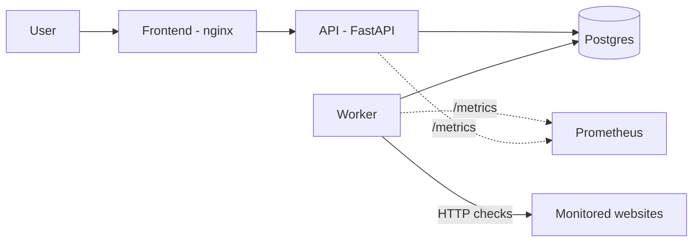
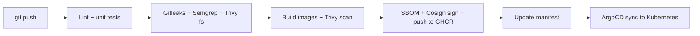

# StatusWatch: Secure CI/CD + GitOps Project

[](https://github.com/ruchitharashmika-tech/statuswatch/actions/workflows/ci.yml)

StatusWatch is a small uptime monitor (frontend, API, worker, Postgres).
The app is simple on purpose: the main goal of this project is the
**DevSecOps pipeline and GitOps delivery** built around it.

## Architecture



## CI/CD flow



Any CRITICAL/HIGH finding fails the pipeline and blocks the merge.

## Tech stack

| Area | Tools |
|---|---|
| App | Python, FastAPI, SQLAlchemy, Postgres, nginx |
| CI | GitHub Actions |
| Security | Hadolint, Gitleaks, Semgrep, Trivy |
| Supply chain | Syft (SBOM), Cosign (keyless signing), GHCR |
| CD | ArgoCD (GitOps) on kind |
| Policy | Kyverno |
| Observability | Prometheus, Grafana |

## Run locally

Requires Docker Desktop.

```
docker compose up --build
```

- App: http://localhost:8080
- API docs: http://localhost:8000/docs
- Worker metrics: http://localhost:9100/metrics

Stop with `Ctrl+C`, then `docker compose down`.

## Project structure

```
statuswatch/
├── services/
│   ├── api/        FastAPI service + tests
│   ├── worker/     background checker + tests
│   └── frontend/   dashboard + nginx
├── k8s/            Kubernetes manifests
├── argocd/         ArgoCD Application
├── policies/       Kyverno policies
├── docs/           screenshots
└── .github/workflows/
```

## Roadmap

- [x] App with 3 services, runs with Docker Compose
- [x] CI: lint, unit tests, Hadolint
- [x] Security gates: Gitleaks, Semgrep, Trivy (filesystem + image)
- [ ] SBOM generation (Syft)
- [ ] Image signing with Cosign (keyless) and push to GHCR
- [ ] Kubernetes manifests and ArgoCD deployment on kind
- [ ] Kyverno policy: only signed images allowed
- [ ] Prometheus + Grafana dashboards
- [ ] Branch protection requiring all checks

## Design decisions

_To be filled in as each stage is built: why Trivy, why keyless signing,
why pull-based CD instead of pushing from CI._

## Results

_Screenshots to add in `docs/`: a blocked build with a vulnerability
report, then the fixed green run._
